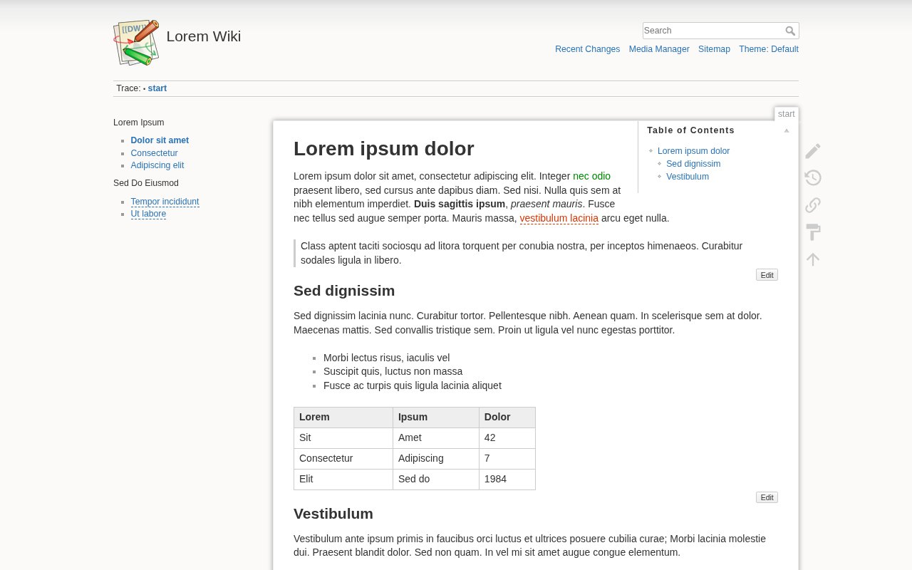
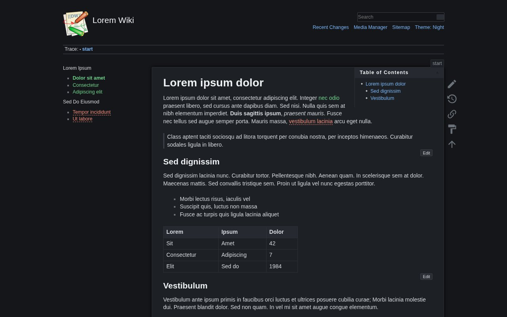
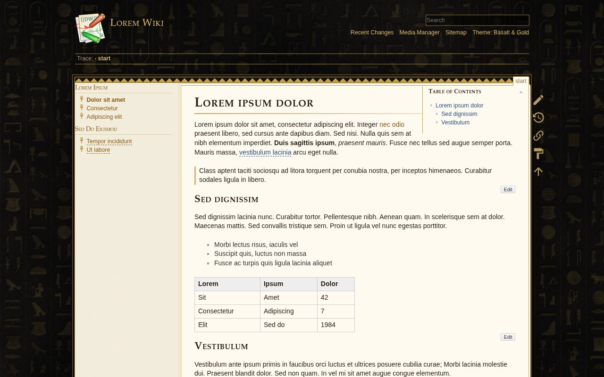
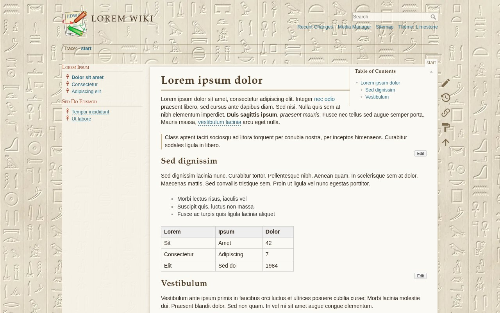
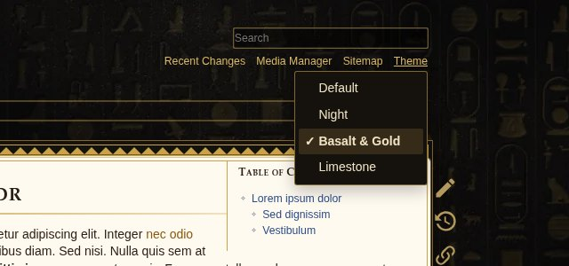

# Theme Switcher plugin for DokuWiki

Let your readers switch between looks you write in CSS: a dark mode, a sepia page, a fully
decorated theme with background images. Each reader's choice is remembered in their browser.

- **Only the shown theme's images are downloaded.** Readers of the default theme never fetch
  the other themes' backgrounds.
- **No flash of the wrong theme.** A tiny script in `<head>` applies the reader's theme before
  the page is drawn.
- **Works with any template** that uses DokuWiki's menus (the default one does), and anywhere
  else through `~~THEMESWITCHER~~`.
- **Optional dark-mode default:** readers whose device is set to dark mode can start on your
  dark theme until they choose.



| Night | Basalt & Gold | Limestone |
|---|---|---|
|  |  |  |

## Install

Search for "Theme Switcher" in the Extension Manager, or put this folder at
`lib/plugins/themeswitcher`.

Out of the box readers get a **Theme** button next to *Sitemap* that switches between the
template's own look and the bundled **Night** theme.

## Writing a theme

A theme is normal CSS (or LESS) scoped to the `data-wiki-theme` attribute that the plugin puts on
`<html>`. Add it to `conf/userstyle.css`, then list its id in the **themes** setting.

```css
html[data-wiki-theme="sepia"] {
    background: #f1e7d0;
}
html[data-wiki-theme="sepia"] body {
    background: #f1e7d0 url(/lib/exe/fetch.php?media=wiki:paper.webp) repeat;
}
html[data-wiki-theme="sepia"] .dokuwiki div.page {
    background: #fbf5e6;
    color: #3b2f22;
}
```

```
themes = default|Default, sepia|Sepia
```

- **Images download only when needed.** A browser fetches a `background: url(...)` image only
  when its rule matches, so each theme's images load only for readers using that theme.
- **A theme with no CSS** shows the template as it is. That is what `default` does above.
- **Winning over the template:** starting every selector with `html[data-wiki-theme="..."]`
  makes it more specific than the template's own rules. Template rules that use an id, such as
  `#dokuwiki__header a`, need the same id in your selector.
- **LESS works** in `conf/userstyle.css`, including the template's `@ini_...` colours.
- **Examples:** the bundled themes in [`examples/examples.less`](examples/examples.less) are a
  good starting point to copy from. They are written for the default template.

## Settings

| Setting | Default | |
|---|---|---|
| `themes` | `default\|Default, night\|Night` | The themes in order, as `id\|Label` separated by commas. Ids use `a-z 0-9 _ -`. |
| `default` | *(empty)* | Theme for readers who haven't chosen. Empty: the first one. |
| `dark` | *(empty)* | Theme for readers whose device is in dark mode and who haven't chosen. |
| `switcher` | `cycle` | `cycle`: one button, each click shows the next theme ("Theme: Night"). `menu`: a button that opens the list of themes. |
| `menu` | `site` | Where the button goes: `site` tools, `user` tools, `page` tools, or `none`. |
| `examples` | on | Include the example themes' CSS. They only appear when listed in `themes`. |

To use all the examples: `default|Default, night|Night, basalt|Basalt & Gold, limestone|Limestone`.

## Placing the switcher yourself

Put `~~THEMESWITCHER~~` in any page, such as the sidebar, to show a switcher there. This also
works in templates that don't use DokuWiki's menus. Set `menu` to `none` if that's the only
switcher you want.

## Details

- **Saved per browser:** the choice is kept in `localStorage`, separately for each wiki on the
  same domain. A choice made in one tab applies to the wiki's other open tabs.
- **Without JavaScript** the switcher is hidden and readers see the template's own look. To show
  them a theme instead, add `html:not([data-wiki-theme])` to that theme's selectors.
- **Phones:** in the default template, *Theme* appears in the tools dropdown and cycles through
  the themes.
- **Turning it off:** adding `themeswitcher` to the `disableactions` setting removes the button.
  Themes still apply.
- **For other scripts:** the current theme is in `document.documentElement.dataset.wikiTheme`,
  and every change fires a `themeswitcher:change` event on `document` with
  `event.detail.theme`.



## License

GPL 2 (see [LICENSE](LICENSE)). The example background images in `examples/images` were made for
this plugin and are under the same license.

Author: TheYellowArchitect <hello@theyellowarchitect.com>
